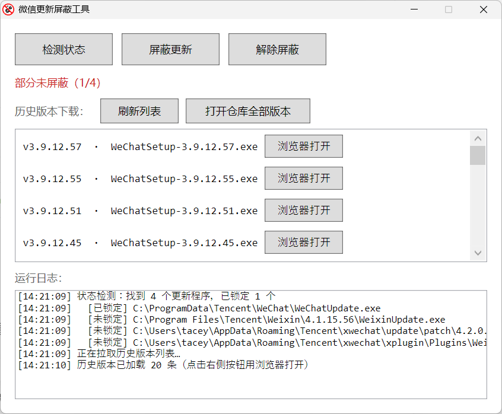

<p align="center">
  
</p>

<h1 align="center">BlockWeChatUpdate</h1>

<p align="center">
  <b>微信 PC 更新屏蔽工具</b><br>
  一键锁定 <code>WeChatUpdate</code> / <code>WeixinUpdate</code>，减少强制升级打扰
</p>

<p align="center">
  
  
  
  
</p>

<p align="center">
  
</p>

---

## 这是什么

PC 微信偶尔会在后台拉起更新程序，打断当前版本。本工具提供一个轻量 GUI：

- 自动查找本机 `WeChatUpdate.exe` / `WeixinUpdate.exe`
- 通过 ACL 拒绝 Users 的读执行、写入、删除权限，降低被覆盖重生概率
- 一键检测 / 屏蔽 / 解除
- 内置微信历史版本下载入口（来自社区归档仓库）

> 微信大版本安装后可能会重新放出更新器，届时再点一次「屏蔽更新」即可。

---

## 功能一览

| 功能 | 说明 |
| --- | --- |
| 检测状态 | 扫描更新程序路径，按 SID / 账户名识别 Deny 规则 |
| 屏蔽更新 | 结束更新进程 → ACL Deny → 清理相关计划任务 |
| 解除屏蔽 | 重置显式 ACL，恢复可执行权限 |
| 历史版本 | 拉取 GitHub Releases 列表，浏览器打开下载页 |

---

## 快速开始

### 方式一：直接运行 EXE（推荐）

1. 下载 Release 中的 `BlockWeChatUpdate.exe`
2. **右键 → 以管理员身份运行**
3. 点击 **屏蔽更新**

### 方式二：运行脚本

```powershell
# 以管理员打开 PowerShell，进入仓库目录后执行
Set-ExecutionPolicy -Scope Process Bypass
.\block-wechat-update.ps1
```

### 方式三：自行打包 EXE

```powershell
Install-Module -Name ps2exe -Scope CurrentUser -Force -AllowClobber
.\build-exe.ps1
```

产物：`BlockWeChatUpdate.exe`

---

## 使用说明

1. 以管理员启动工具
2. 顶部状态栏会显示当前是否已屏蔽
3. 点击 **屏蔽更新** 完成锁定
4. 需要恢复更新时，点击 **解除屏蔽**
5. 下方列表可刷新并打开历史版本下载页

### 界面按钮

| 按钮 | 作用 |
| --- | --- |
| 检测状态 | 重新扫描并刷新锁定状态 |
| 屏蔽更新 | 锁定更新程序并清理计划任务 |
| 解除屏蔽 | 恢复更新程序权限 |
| 刷新列表 | 重新拉取历史版本 |
| 打开仓库全部版本 | 在浏览器打开归档仓库 |

---

## 原理简述

工具不会注入微信进程，而是对更新程序文件施加 **Users Deny (RX,W,D)**：

```text
找到 WeChatUpdate.exe / WeixinUpdate.exe
        │
        ▼
  icacls /deny Users:(RX,W,D)
        │
        ▼
  普通用户无法执行 / 覆盖 / 删除
        │
        ▼
     更新被阻断
```

解除时使用 `icacls /reset`（失败时回退移除 Deny），并兼容历史误加的 SYSTEM / Administrators Deny。

---

## 目录结构

```text
BlockWeChatUpdate/
├── block-wechat-update.ps1   # 主程序（WPF GUI）
├── build-exe.ps1             # ps2exe 打包脚本
├── BlockWeChatUpdate.exe     # 打包产物
├── logo.svg / logo.ico       # 图标
├── screenshot.png            # 界面截图
└── README.md
```

---

## 注意事项

- 必须以 **管理员权限** 运行，否则无法修改 ACL
- 仅面向本机微信 PC 客户端；不修改微信安装包本身
- 微信升级后可能重新生成更新器，需再次屏蔽
- 历史版本来自社区仓库 [cscnk52/wechat-windows-versions](https://github.com/cscnk52/wechat-windows-versions)，下载请自行甄别风险
- 本工具按「自用便利」提供，使用后果自负

---

## 致谢

- [cscnk52/wechat-windows-versions](https://github.com/cscnk52/wechat-windows-versions) — 微信 Windows 历史版本归档
- [MScholtes/PS2EXE](https://github.com/MScholtes/PS2EXE) — PowerShell 脚本打包

---

## License

MIT © TaceyWong / 白昼寻星工作室
